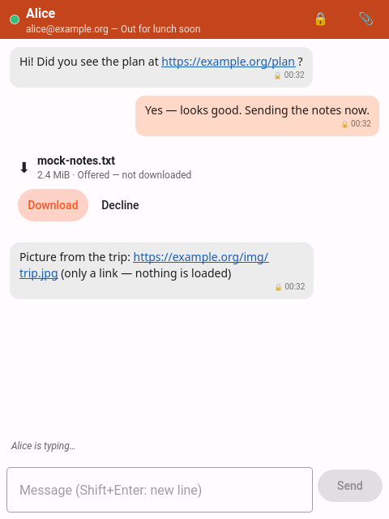
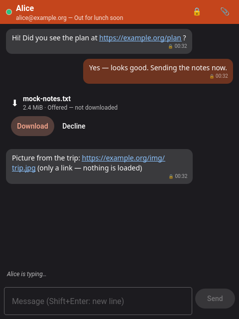

#  Jaba da Hat

      

A Jabber/XMPP-only instant messenger for GNOME that lives in the system tray.
No other protocols, no plugins: just XMPP done properly.

Why? Because Pidgin crashes on Ubuntu 26.06 and psi too and others are, well, lame.

> **Status: 1.0.3.** Connects to real XMPP servers (login, contacts, presence,
> subscriptions, messages, typing, server history) and transfers files over Jingle or HTTP
> Upload, with pause / resume, and encrypts chats and files with OMEMO (you approve every device,
> per chat window). See [docs/PLAN.md](docs/PLAN.md).

## Features

- Tray icon: a coloured status circle, or an envelope / file / note that wiggles when something
  is waiting; double click opens the unread chat, everything else is in the menu
- Own toast notifications in the top-right corner (also when GNOME's Do Not Disturb hides banners)
- Presence: available / away / do not disturb / offline; log on / log off; automatic login and reconnect
- Contacts submenu (only online / all), single click opens a chat
- Chat window: remote side left, you right, clickable links, **nothing is ever auto-loaded**,
  conversation kept **in memory only** while the window is open
- File transfer with progress, cancel, pause and resume (Jingle FT, HTTP Upload fallback — 0.3.0)
- End-to-end encryption with OMEMO (0.4.0)
- Contact management: add, remove, remove & block, multi-select, user groups, drag & drop grouping
- Notifications for authorization requests and problems; declining really declines
  (`unsubscribed`), so the request doesn't come back at every login
- GNOME notifications for new messages; light / dark / follow-system theme
- Starts with your session, quits cleanly at logout

## Requirements

- Ubuntu / GNOME on Wayland (X11 works too). GNOME needs a tray: Ubuntu's built-in *AppIndicator*
  extension, or the "AppIndicator and KStatusNotifierItem Support" extension elsewhere.
- For building or running from source: [uv](https://docs.astral.sh/uv/). Everything else
  (Python packages, Nuitka) goes into the project's `.venv`, nothing is installed system-wide.

## Run from source

```bash
./run.sh                    # starts in the tray
./run.sh --open contacts    # also open the contacts window right away
./run.sh --help
```

`./run.sh --mock` uses a built-in mock backend with made-up contacts (`@example.org`)
instead of a server. Its tray menu has a **Mock / testing** submenu to simulate an incoming
message, an authorization request, an incoming file and a dropped connection; the password
`wrong` simulates a failed login.

### Test server

A throw-away [Prosody](https://prosody.im) in Docker, with test accounts `me`, `alice` and
`bob` `@localhost` (password `test-password`) and an HTTP Upload service for file transfer
(`https://localhost:15281`):

```bash
tools/test-server.sh start     # also creates a test CA in build/prosody/
./run.sh --config /tmp/jdh-me.json --ca-file build/prosody/ca.crt
tools/test-server.sh stop      # deletes the container with all accounts and history
```

In Settings use Jabber ID `me@localhost`, server `127.0.0.1`, port `15222`. A second
instance with another `--config` file can log in as `alice@localhost` to chat with yourself.
`--config` keeps the test account out of your real `~/.config/jaba-da-hat/config.json`.

## Build a single binary

```bash
./build.sh                  # → build/jdh-<version>, e.g. build/jdh-1.0.3
./build/jdh-1.0.3 --register     # register for your user: launcher (.desktop) + icon
./build/jdh-1.0.3 --unregister   # remove launcher, autostart entry and icon
```

At every start the binary checks the registration: if the app is not registered it registers
itself, and if an older version is registered it re-registers, so the launcher and the autostart
entry point to the new binary. A newer registered version is left alone.

The tray icon is as big as the panel lets it be. To make all tray icons bigger, raise the
AppIndicator extension's icon size (0 = panel default), e.g.
`gsettings set org.gnome.shell.extensions.appindicator icon-size 24`.

The binary is self-contained (Python, Qt and the QML files are inside). On first start it
unpacks to `~/.cache/jaba-da-hat/<version>`, so later starts are fast.
"Start when I log in" in Settings writes `~/.config/autostart/jaba-da-hat.desktop`
pointing at the binary (or at the venv when run from source).

## Configuration

`~/.config/jaba-da-hat/config.json` (mode 0600, because it contains the password).
OMEMO keys live in `~/.local/share/jaba-da-hat/omemo/` (mode 0600); device approvals are never stored.
Received files go to `~/Downloads` unless changed in Settings.

## Development

```bash
uv sync                                                    # create / update .venv
uv run pytest                                              # tests (Qt runs offscreen)
JDH_XMPP_TEST=1 uv run pytest tests/test_xmpp_integration.py  # against Prosody (needs docker)
tools/audit.sh                                             # known CVEs in any dependency (build.sh runs it too)
tools/package-check.sh                                     # built binary on a simulated new account
QT_QPA_PLATFORM=offscreen uv run python tools/screenshots.py   # refresh README screenshots
QT_QPA_PLATFORM=offscreen uv run python tools/gen_icons.py     # rescale icons from assets/app-icon.png
```

- Work happens on the `dev` branch; `main` only receives tested releases.
- Versioning: [SemVer](https://semver.org); version lives in `pyproject.toml` **and**
  `src/jaba_da_hat/__init__.py` (`build.sh` refuses to build if they differ).
- Changes are recorded in [CHANGELOG.md](CHANGELOG.md).
- Long "why" comments live in [docs/comments-details.md](docs/comments-details.md), referenced from code as `[N]`.
- Protocol references: `docs/rfc/` (core RFCs + the XEPs used).

## License

MIT, see [LICENSE](LICENSE).
