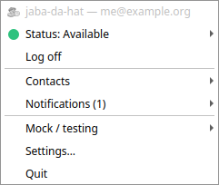
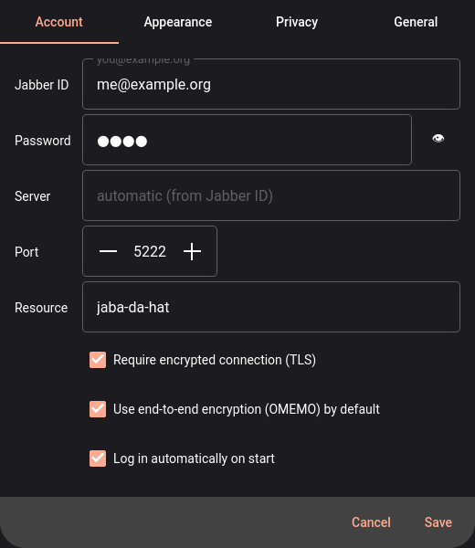

#  jaba-da-hat

    

A Jabber/XMPP-only instant messenger for GNOME that lives in the system tray.
No other protocols, no plugins: just XMPP done properly.

> **Status: 0.1.0 — UI preview.** Everything runs on a built-in *mock backend* with made-up
> contacts (`@example.org`). No network connection is made yet. Real XMPP arrives in 0.2.0,
> see [docs/PLAN.md](docs/PLAN.md).

## Features

- Tray icon showing your presence and unread messages; everything is reachable from its right-click menu
- Presence: available / away / do not disturb / offline; log on / log off; automatic login and reconnect
- Contacts submenu (only online / all), single click opens a chat
- Chat window: remote side left, you right, clickable links, **nothing is ever auto-loaded**,
  conversation kept **in memory only** while the window is open
- File transfer with progress, cancel, pause and resume (Jingle FT, HTTP Upload fallback — 0.3.0)
- End-to-end encryption with OMEMO (0.4.0)
- Contact management: add, remove, remove & block, multi-select, user groups, drag & drop grouping
- Notifications for authorization requests and problems; declining really declines
  (`unsubscribed`), so the request doesn't come back at every login
- GNOME notifications for new messages; light / dark / follow-system theme
- Starts with your session, quits cleanly at logout

## Requirements

- Linux with GNOME (Wayland or X11). GNOME needs a tray: Ubuntu's built-in *AppIndicator*
  extension, or the "AppIndicator and KStatusNotifierItem Support" extension elsewhere.
- For building or running from source: [uv](https://docs.astral.sh/uv/). Everything else
  (Python packages, Nuitka) goes into the project's `.venv`, nothing is installed system-wide.

## Run from source

```bash
./run.sh                    # starts in the tray
./run.sh --open contacts    # also open the contacts window right away
./run.sh --help
```

In 0.1.x the tray menu has a **Mock / testing** submenu to simulate an incoming message,
an authorization request, an incoming file and a dropped connection. Use the password `wrong`
in Settings to simulate a failed login.

## Build a single binary

```bash
./build.sh                  # → build/jdh-<version>, e.g. build/jdh-0.1.0
./build/jdh-0.1.0 --install-desktop    # launcher + icon in ~/.local/share
./build/jdh-0.1.0 --uninstall-desktop  # remove them (and the autostart entry)
```

The binary is self-contained (Python, Qt and the QML files are inside). On first start it
unpacks to `~/.cache/jaba-da-hat/<version>`, so later starts are fast.
"Start when I log in" in Settings writes `~/.config/autostart/jaba-da-hat.desktop`
pointing at the binary (or at the venv when run from source).

## Configuration

`~/.config/jaba-da-hat/config.json` (mode 0600, because it contains the password).
Received files go to `~/Downloads` unless changed in Settings.

## Development

```bash
uv sync                                                    # create / update .venv
uv run pytest                                              # tests (Qt runs offscreen)
QT_QPA_PLATFORM=offscreen uv run python tools/screenshots.py   # refresh README screenshots
QT_QPA_PLATFORM=offscreen uv run python tools/gen_icons.py     # rescale icons from assets/app-icon.png
```

- Work happens on the `dev` branch; `main` only receives tested releases.
- Versioning: [SemVer](https://semver.org); version lives in `pyproject.toml` **and**
  `src/jaba_da_hat/__init__.py` (`build.sh` refuses to build if they differ).
- Changes are recorded in [CHANGELOG.md](CHANGELOG.md).
- Long "why" comments live in [docs/comments-details.md](docs/comments-details.md), referenced from code as `[N]`.
- Protocol references: `docs/rfc/` (core RFCs + the XEPs used).

## License

MIT, see [LICENSE](LICENSE).
